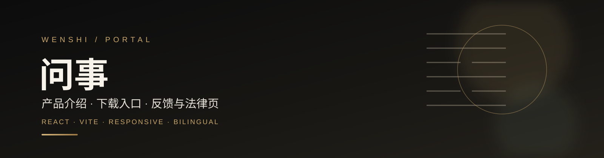
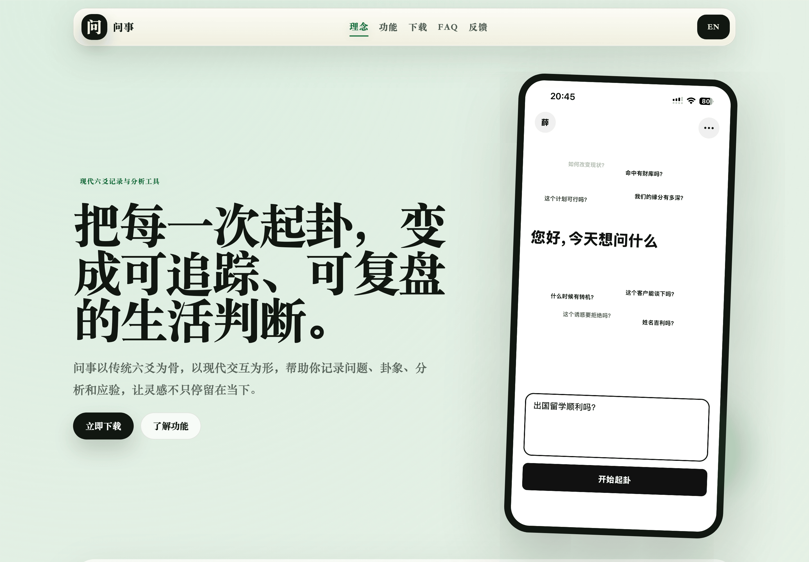
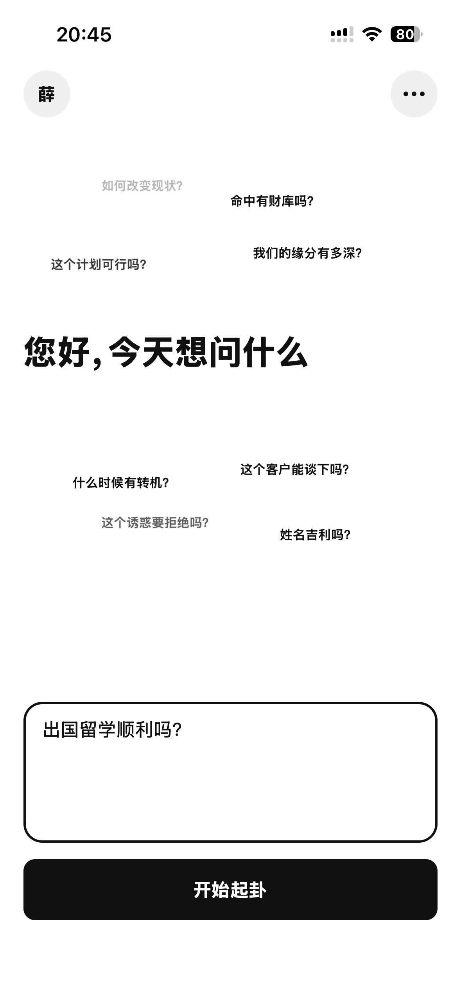
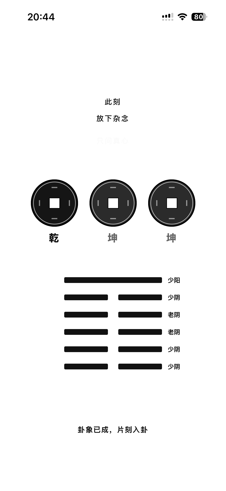
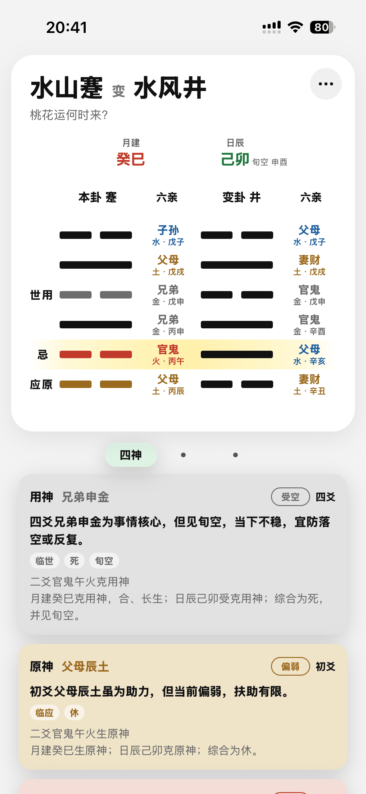

<p align="center">
  
</p>

# 问事 Portal

[](https://github.com/Xuezhihengg/wenshi_portal/actions/workflows/ci.yml)
[](LICENSE)
[](https://react.dev)
[](https://vite.dev)
[](https://www.typescriptlang.org)

问事官网：产品介绍、下载入口、隐私政策、服务条款、账号删除说明与反馈表单。它是 [wenshi-app](https://github.com/Xuezhihengg/wenshi_app) 的公开门面，也是用户与运营团队之间的反馈入口。

> The public landing site for Wenshi, a modern Liuyao journaling app. Built with React and Vite, with bilingual content, legal pages, download links and a feedback form wired to the Wenshi backend.

<p align="center">
  
</p>

在线访问：[https://wenshi.xin](https://wenshi.xin)

## 功能

| 模块 | 能力 |
| --- | --- |
| 首页 | 品牌主张、产品理念、功能亮点、使用流程、FAQ 与下载引导 |
| 双语 | 中文 / English 切换，页面文案与法律文本分别维护 |
| 法律页 | 隐私政策、服务条款、账号删除说明 |
| 反馈 | 公开反馈表单，提交到 `POST /api/v1/public/feedback` |
| 统计 | 门户访问统计，提交到 `POST /api/v1/public/portal-visit` |
| 体验 | 响应式布局、移动端适配、轻量静态部署 |

## 移动端预览

<p align="center">
  
  
  
</p>

## 页面结构

| 区块 | 内容 |
| --- | --- |
| 理念 | 为什么把六爻当作可复盘的生活判断工具 |
| 功能 | 起卦、结构化分析、AI 解读、档案与归档 |
| 流程 | 从提问到复盘的完整使用路径 |
| 下载 | App Store / Google Play 等官方入口 |
| FAQ | 新手上手、记录同步、反馈处理等常见问题 |
| 反馈 | 类型、联系方式、描述与截图上传 |

## 技术栈

| 层级 | 技术 |
| --- | --- |
| 框架 | React 19 |
| 构建 | Vite 8、TypeScript 6 |
| 样式 | 原生 CSS，移动端优先的响应式布局 |
| 部署 | 静态文件 + Nginx，或 Docker |
| 后端 | [wenshi-server](https://github.com/Xuezhihengg/wenshi_server) |

## 快速开始

### 环境要求

- Node.js 20.19+
- npm

### 安装与启动

```bash
git clone https://github.com/Xuezhihengg/wenshi_portal.git
cd wenshi-portal
cp .env.example .env
npm ci
npm run dev
```

默认访问 http://127.0.0.1:5174。

### 构建

```bash
npm run typecheck
npm run build
```

构建产物在 `dist/`。本地预览：

```bash
npm run preview
```

## 环境变量

| 变量 | 说明 |
| --- | --- |
| `VITE_API_BASE_URL` | 后端 API 地址，默认 `http://localhost:8000` |

生产环境通常设为 `/`，让官网通过同源 Nginx 调用 API：

```env
VITE_API_BASE_URL=/
```

## 部署

### Docker

```bash
docker build -t wenshi-portal .
```

### 完整生产编排

官网通常由 [wenshi-server](https://github.com/Xuezhihengg/wenshi_server) 的 Docker Compose 统一构建和代理。将两个仓库放在同一父目录后：

```bash
cd wenshi-server
docker compose -f docker-compose.yml -f docker-compose.prod.yml up -d --build
```

Nginx 将 `/` 指向门户静态文件，将 `/api/v1/` 与 `/uploads/` 转发到后端。完整步骤见 [wenshi-server 部署文档](https://github.com/Xuezhihengg/wenshi_server/blob/main/docs/DEPLOYMENT.md)。

## 内容维护

| 文件 | 用途 |
| --- | --- |
| `src/main.tsx` | 页面文案、双语内容、法律文本与反馈表单 |
| `src/styles.css` | 全局样式与响应式规则 |
| `public/assets/` | 产品截图与静态资源 |
| `index.html` | SEO、canonical URL 与页面元信息 |

修改文案或法律条款时，请同时检查中文与英文两个版本。

## 关联仓库

- [wenshi-app](https://github.com/Xuezhihengg/wenshi_app)：Expo / React Native 客户端
- [wenshi-server](https://github.com/Xuezhihengg/wenshi_server)：FastAPI 后端、管理后台与部署编排

## 安全

反馈表单会写入后端数据库。提交测试内容时请使用虚构信息，不要提交真实手机号、邮箱或截图。漏洞报告方式见 [SECURITY.md](SECURITY.md)。

## 贡献

欢迎提交 Issue 与 Pull Request，开始前请阅读 [CONTRIBUTING.md](CONTRIBUTING.md) 和 [CODE_OF_CONDUCT.md](CODE_OF_CONDUCT.md)。

## License

[MIT](LICENSE)。项目名称、Logo 与截图不随代码许可授权，详见 [TRADEMARKS.md](TRADEMARKS.md)。
